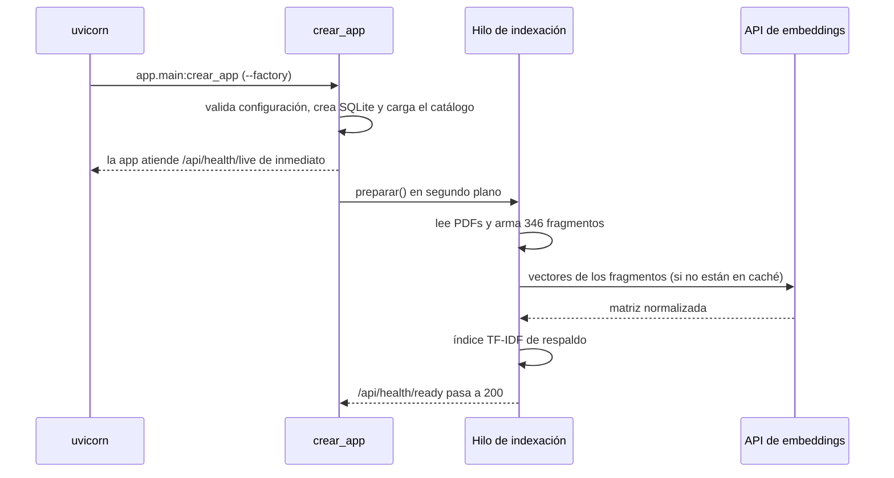
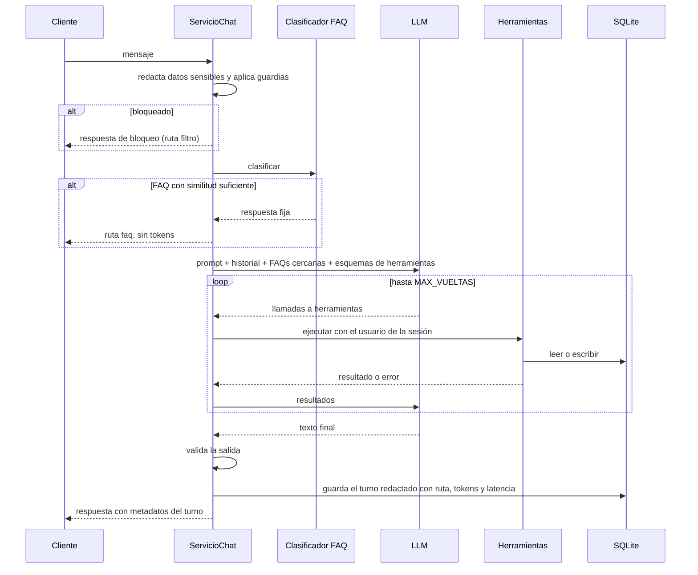
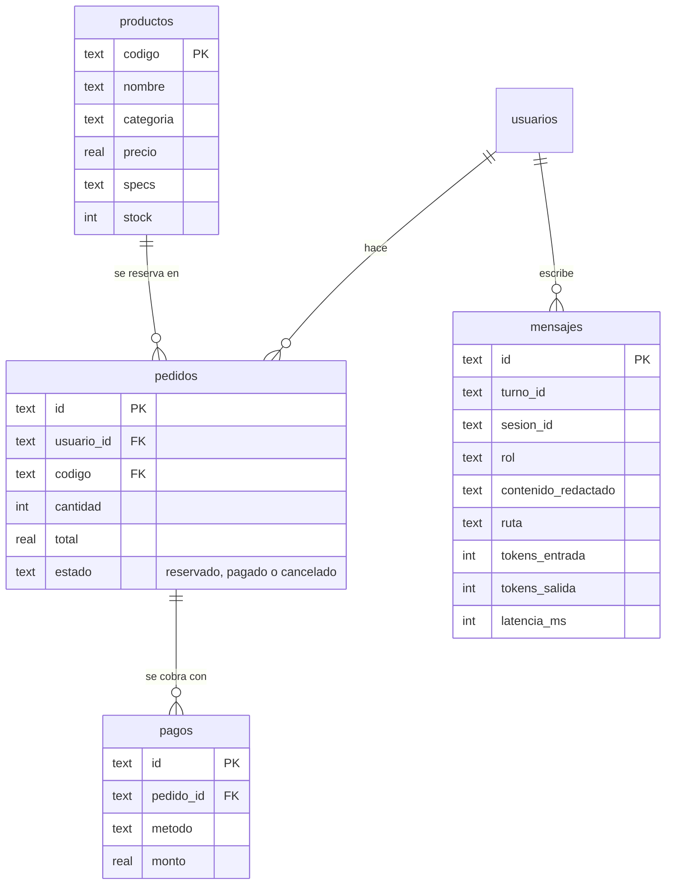

# Arquitectura

Este documento describe los componentes, el flujo de un turno, el modelo de datos y los eventos del registro. La vista general y el stack están en el [README](../README.md).

## Componentes y responsabilidades

| Módulo | Responsabilidad | Depende de |
|---|---|---|
| `app/main.py` | Fábrica de la app: middlewares de seguridad, rutas, frontend y ciclo de vida | todo lo demás |
| `app/api/rutas.py` | Endpoints HTTP públicos y de administración | `dependencias`, `esquemas` |
| `app/api/dependencias.py` | Estado compartido (`EstadoApp`), token de administración, IP del cliente | `servicios.chat` |
| `app/api/limitador.py` | Límite de peticiones por cliente con ventana deslizante | nada |
| `app/core/config.py` | Lectura y validación del `.env` | pydantic-settings |
| `app/core/logs.py` | Eventos por turno en consola y JSONL | `config` |
| `app/core/seguridad.py` | Redacción, guardias y validación de salida (funciones puras) | nada |
| `app/llm/cliente.py` | Chat compatible con OpenAI, herramientas y respaldo | httpx |
| `app/llm/embeddings.py` | Embeddings por API, lotes y reintentos | httpx, numpy |
| `app/persistencia/db.py` | `BaseDatos`: reúne los repositorios en un solo punto de acceso | `tienda`, `conversacion` |
| `app/persistencia/esquema.py` | Tablas, errores de pedido y conversión de filas | sqlite3 |
| `app/persistencia/conexion.py` | Conexión, creación del esquema y carga del catálogo | `esquema` |
| `app/persistencia/tienda.py` | Productos, usuarios, pedidos y pagos con transacciones | `conexion` |
| `app/persistencia/conversacion.py` | Mensajes de cada sesión y métricas por ruta | `conexion` |
| `app/servicios/faq.py` | Clasificador TF-IDF de preguntas frecuentes | scikit-learn |
| `app/servicios/rag.py` | Fragmentos, índice denso y TF-IDF, caché y MMR | pypdf, numpy, `llm.embeddings` |
| `app/servicios/herramientas.py` | Esquemas y ejecución de las 7 herramientas | `db`, `rag` |
| `app/servicios/chat.py` | El turno completo, paso a paso | `turno`, `faq`, `rag`, `herramientas` |
| `app/servicios/turno.py` | Ajustes, respuesta del turno, ejecución de herramientas con sus eventos y modo demo | `herramientas`, `db` |
| `app/servicios/fabrica.py` | `construir_servicio`: arma el servicio real desde la configuración | todos los servicios |

Las dependencias van en un solo sentido: la API conoce a los servicios, los servicios conocen a la persistencia y a los clientes de modelos, y nada de lo anterior conoce a FastAPI. Por eso el turno completo se prueba sin servidor HTTP, con un modelo simulado.

## Arranque

Si la API de embeddings falla al indexar, el buscador queda con TF-IDF, la app pasa igual a lista y `/api/health` informa el motor usado y el aviso.

## Un turno de conversación

Detalles que importan:

- El `usuario_id` de las herramientas viene de la sesión, nunca de los argumentos que propone el modelo.
- Las herramientas de solo lectura repetidas dentro de un turno se ejecutan una vez.
- Si se agotan las vueltas, se hace una última llamada sin herramientas para cerrar la respuesta.
- Si ningún proveedor responde, el turno se resuelve en modo demo con la FAQ más cercana o con el catálogo.

## Modelo de datos

La reserva descuenta stock con `update ... where stock >= cantidad` dentro de una transacción `begin immediate`: dos reservas simultáneas no pueden vender la última unidad dos veces.

## Registro de eventos

Regla de diseño: un dato, un dueño. Lo que se consulta o suma (pedidos, tokens, latencia) vive en la base; lo que explica qué pasó vive en el log. Cada evento lleva el `turno_id`.

| Evento | Nivel | Cuándo |
|---|---|---|
| `app.inicio` | INFO | Arranca la app (versión, entorno, si hay LLM y embeddings) |
| `corpus.indexando`, `corpus.listo`, `corpus.error` | INFO o ERROR | Indexación de los PDFs |
| `turno.inicio` | INFO | Llega un mensaje |
| `dato.enmascarado` | INFO | Se redactó una tarjeta o clave |
| `guardia.inyeccion`, `guardia.palabra_prohibida` | WARN | Mensaje bloqueado |
| `clasificacion`, `faq.hit`, `escalado` | INFO o WARN | Decisión del clasificador |
| `llm.llamada`, `llm.lento` | INFO o WARN | Cada llamada al modelo y su latencia |
| `herramienta.ejecutada` | INFO | Cada herramienta con resultado y duración |
| `rag.recuperado` | INFO | Fragmentos elegidos, mejor puntaje y motor |
| `pedido.creado`, `pedido.cobrado`, `pedido.cancelado` | INFO | Cambios en pedidos |
| `salida.bloqueada`, `salida.redactada` | WARN o INFO | La validación de salida actuó |
| `degradacion` | WARN | Sin proveedor: modo demo |
| `limite.superado` | WARN | Un cliente superó el límite por minuto |
| `turno.fin` | INFO | Cierre con ruta, latencia y tokens |

En local la consola muestra una línea legible por evento; en Azure (`LOG_FORMATO=json`) cada línea es un JSON que Log Analytics indexa. En ambos casos se escribe además `var/logs/eventos.jsonl`, que alimenta el panel de logs del frontend.
