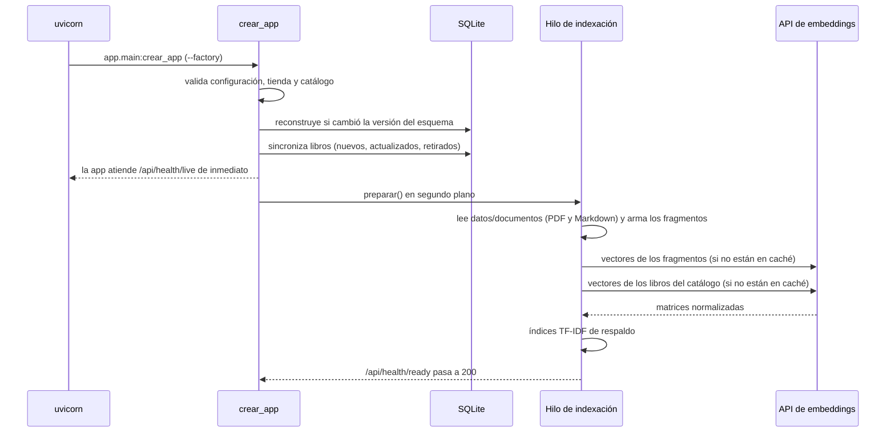
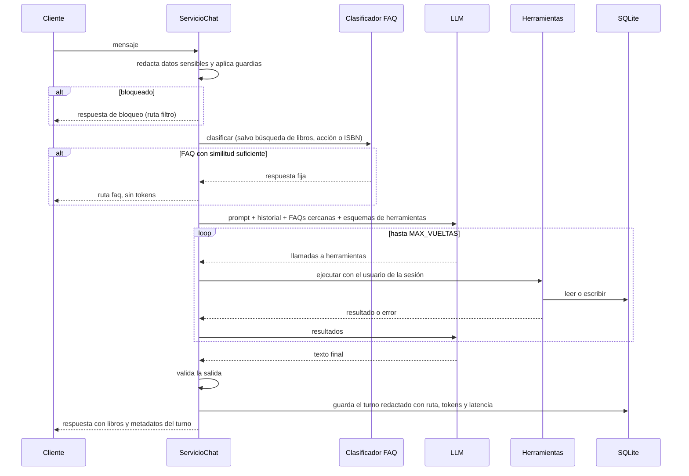
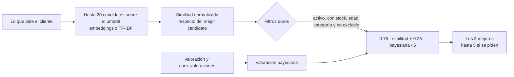
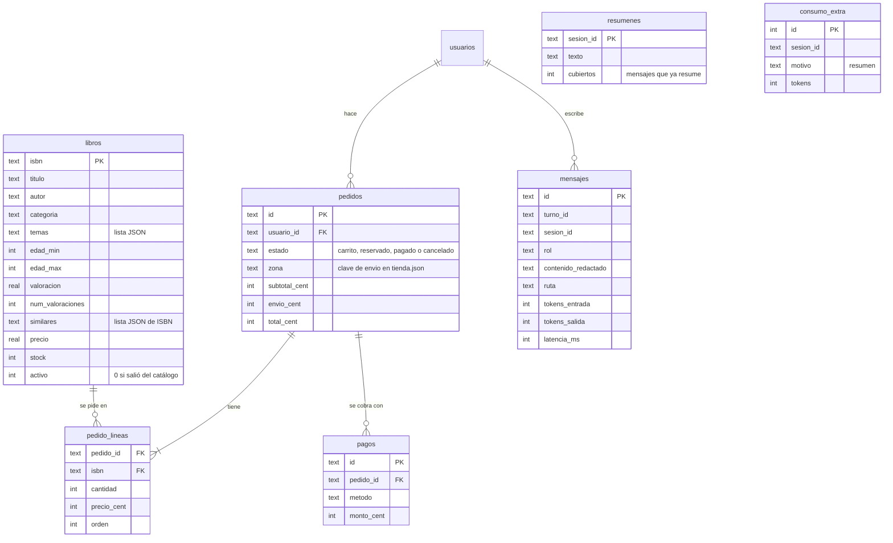

# Arquitectura

Este documento describe los componentes, el arranque, el flujo de un turno, el modelo de datos y los eventos del registro. La vista general y el stack están en el [README](../README.md).

## Componentes y responsabilidades

| Módulo | Responsabilidad | Depende de |
|---|---|---|
| `app/main.py` | Fábrica de la app: carga la tienda, sincroniza el catálogo, middlewares de seguridad, rutas, frontend y ciclo de vida | todo lo demás |
| `app/api/rutas.py` | Endpoints HTTP públicos y de administración | `dependencias`, `esquemas` |
| `app/api/dependencias.py` | Estado compartido (`EstadoApp`), indexación en segundo plano, token de administración, IP del cliente | `servicios.chat` |
| `app/api/limitador.py` | Límite de peticiones por cliente con ventana deslizante | nada |
| `app/api/acceso.py` | Acceso de la demo: inicio y cierre de sesión, límites de intentos y dependencia que protege la API | `dependencias`, `core.claves` |
| `app/api/sesiones.py` | Sesiones en memoria con vencimiento | nada |
| `app/catalogo/modelo.py` | Esquema de un libro (`Libro`) con sus validaciones y el texto que se usa para buscarlo | pydantic, `core.isbn` |
| `app/catalogo/carga.py` | Carga del catálogo y de la tienda; reúne todos los errores en un `ErrorCatalogo` y lista advertencias | `modelo` |
| `app/core/config.py` | Lectura y validación del `.env` | pydantic-settings |
| `app/core/claves.py` | Hash y verificación de claves con PBKDF2-SHA256 | nada |
| `app/core/isbn.py` | Normalización de ISBN, dígito verificador y detección en un texto | nada |
| `app/core/texto.py` | Normalización de texto sin tildes ni signos | nada |
| `app/core/logs.py` | Eventos por turno en consola y JSONL | `config` |
| `app/core/seguridad.py` | Redacción, guardias y validación de salida (funciones puras) | `core.isbn` |
| `app/llm/cliente.py` | Chat compatible con OpenAI, herramientas y respaldo | httpx |
| `app/llm/embeddings.py` | Embeddings por API y lotes | httpx, numpy |
| `app/llm/reintentos.py` | Reintentos ante 429, 5xx y cortes de red, con espera creciente y `Retry-After` | httpx |
| `app/llm/tope.py` | Tope de tokens en 24 horas: al pasarlo, el turno sigue en modo demo | — |
| `app/persistencia/db.py` | `BaseDatos`: reúne los repositorios en un solo punto de acceso | `tienda`, `conversacion` |
| `app/persistencia/esquema.py` | Tablas, versión del esquema, errores de pedido y conversión de filas | sqlite3 |
| `app/persistencia/conexion.py` | Conexión, reconstrucción por versión y sincronización del catálogo | `esquema`, `catalogo.carga` |
| `app/persistencia/catalogo.py` | Libros activos, ficha por ISBN, búsqueda por palabras completas y categorías | `conexion` |
| `app/persistencia/tienda.py` | Usuarios, pedidos y pagos con transacciones | `persistencia.catalogo` |
| `app/persistencia/conversacion.py` | Mensajes de cada sesión y métricas por ruta | `conexion` |
| `app/servicios/faq.py` | Clasificador TF-IDF de preguntas frecuentes | scikit-learn |
| `app/servicios/rag.py` | Fragmentos de PDF y Markdown, índice denso y TF-IDF, caché y MMR | pypdf, numpy, `llm.embeddings` |
| `app/servicios/recomendador.py` | Recomendador híbrido: similitud por contenido, valoración bayesiana y filtros | `rag`, `persistencia.catalogo` |
| `app/servicios/esquemas_herramientas.py` | Las 10 herramientas que ve el modelo, cuáles son idempotentes y cuáles son acciones | nada |
| `app/servicios/herramientas.py` | Ejecución de las herramientas | `db`, `rag`, `recomendador` |
| `app/servicios/chat.py` | El turno completo, paso a paso | `turno`, `faq`, `rag`, `herramientas` |
| `app/servicios/contexto.py` | Lo que ve el modelo (prompt, FAQ cercanas, historial y mensaje) y el candado por sesión: dos mensajes de la misma conversación se atienden en orden, nunca a la vez | `db`, `faq` |
| `app/servicios/resumen.py` | Resumen encadenado de lo que sale de la ventana del historial: cada 8 mensajes nuevos, en segundo plano, con los ISBN y los ids copiados tal cual | `db`, `cliente` |
| `app/servicios/turno.py` | Ajustes, guardias de acción y búsqueda, respuesta del turno, ejecución de herramientas con sus eventos y modo demo | `herramientas`, `recomendador`, `db` |
| `app/servicios/verificacion.py` | Revisa la respuesta del modelo contra la base y el turno antes de entregarla | `db`, `turno` |
| `app/servicios/fabrica.py` | `construir_servicio`: arma el servicio real desde la configuración y `datos/` | todos los servicios |

Las dependencias van en un solo sentido: la API conoce a los servicios, los servicios conocen a la persistencia y a los clientes de modelos, y nada de lo anterior conoce a FastAPI. Por eso el turno completo se prueba sin servidor HTTP, con un modelo simulado.

## Herramientas

| Herramienta | Tipo | Qué hace |
|---|---|---|
| `buscar_libros` | lectura | Busca por título, autor, saga o ISBN, con filtros de categoría, edad y presupuesto. Tolera errores de tipeo (`correcciones`) y, si encuentra menos de tres libros, agrega `relacionados` del recomendador |
| `recomendar_libros` | lectura | Recomienda por lo que describe el cliente, con filtros de edad, categoría y presupuesto; excluye los libros ya ofrecidos o leídos |
| `ficha_libro` | lectura | Ficha completa y similares que siguen disponibles |
| `buscar_politica` | lectura | RAG sobre las políticas y el manual del consumidor |
| `consultar_pedido` | lectura | Estado, líneas y montos de un pedido del cliente |
| `actualizar_carrito` | acción | Fija la cantidad de cada libro y la zona de envío; devuelve subtotal, envío, total y un resumen redactado por el sistema |
| `reservar_pedido` | acción | Reserva el carrito: descuenta el stock de todas las líneas y fija los montos |
| `cobrar_pedido` | acción | Cobra un pedido reservado, o reserva y cobra un carrito; se rechaza si el total cambió en el mismo turno |
| `cancelar_pedido` | acción | Cancela un carrito o una reserva y devuelve el stock |
| `derivar_a_persona` | escalado | Registra el motivo y devuelve el teléfono, el correo y el horario de atención de `tienda.json`; el turno queda con ruta `escalar` |

La búsqueda corrige errores de tipeo con `difflib`, pero con cuidado, porque corregir de más cambia el pedido del cliente por otro libro. Una palabra que no está en el catálogo se cambia por la más parecida solo si:
- el parecido es de 0.75 o más (con 0.68, probado sobre el catálogo real, "cocina" pasaba a "conan");
- empieza con la misma letra y difiere en una letra de largo como máximo;
- después de corregir, todas las palabras de la consulta existen en el catálogo y aparecen juntas en un mismo libro.

Así "el silmarilion" encuentra El Silmarillion y "brandon sandersen" a Brandon Sanderson, pero "harry poter" o "garcia marques", que no están, no se convierten en otros libros.

## Orden del prompt y caché

Qwen reutiliza de su caché el prefijo de un pedido que ya vio, y esos tokens se cobran más baratos. Por eso lo que cambia en cada turno va al final: el mensaje de sistema (prompt y, si hay, el resumen de la conversación), las herramientas y el historial forman un prefijo fijo, y las preguntas frecuentes cercanas viajan pegadas al mensaje del cliente, marcadas como contexto interno. Medido con `qwen-plus`: con las FAQ al final del mensaje de sistema se servían de caché 3 968 de 5 727 tokens (69 %); con las FAQ en el mensaje del cliente, 5 632 de 5 728 (98 %). Un segundo mensaje de sistema en medio de la conversación no sirve: anuló la caché (0 tokens). El historial guarda solo lo que escribió el cliente, sin esa nota.

En el mensaje del cliente, una FAQ poco parecida pesa más que en el de sistema. Con el mínimo de contexto de 0.25, a "quiero ciencia ficción con robots que investigan crímenes" se le pegaba la FAQ de devoluciones (similitud 0.30), y el modelo buscó por título en dos de tres intentos en vez de recomendar. Sin esa FAQ recomendó en cuatro de cuatro y en la mitad del tiempo. Por eso `FAQ_PROMPT_MIN` (0.5) decide qué FAQ se adjuntan; en la muestra medida, las preguntas de libros quedaron entre 0.22 y 0.48 y casi todas las de políticas entre 0.57 y 0.77. `FAQ_CONTEXTO_MIN` (0.25) sigue decidiendo cuándo un tema crítico se deriva y qué FAQ cercana usa el modo demo.

## Arranque

Si el catálogo o la tienda tienen datos inválidos, la app no arranca y el error lista cada problema con el libro, el ISBN y el campo; la base no se toca. Si la API de embeddings falla al indexar, los documentos y el catálogo quedan con TF-IDF, la app pasa igual a lista y `/api/health` informa el motor usado y el aviso.

## Un turno de conversación

Detalles que importan:

- El `usuario_id` de las herramientas viene de la sesión, nunca de los argumentos que propone el modelo.
- Las herramientas de solo lectura repetidas dentro de un turno se ejecutan una vez.
- Los libros que devuelven `buscar_libros`, `recomendar_libros` y `ficha_libro` se juntan, sin repetir, en el campo `libros` de la respuesta.
- Si se agotan las vueltas, se hace una última llamada sin herramientas para cerrar la respuesta.
- Si ningún proveedor responde, el turno se resuelve en modo demo: un ISBN se busca en el catálogo, lo demás pasa por el recomendador (con la edad del mensaje, si la tiene) y, si no hay libros, se usa la FAQ más cercana.
- Antes de entregar la respuesta del modelo, `verificacion.py` la compara con lo que pasó de verdad: todo id `PED-…` o `PAG-…` debe existir para ese cliente, un pago o una cancelación que la respuesta afirme deben estar en la base o haberse hecho en el turno, una cita de política exige haber llamado a `buscar_politica`, y si el cliente ya dijo qué busca y la edad del lector, responder con una pregunta sin haber recomendado no pasa. Si algo no cuadra, el modelo recibe una corrección y tiene una vuelta más; si vuelve a fallar, el cliente recibe un mensaje seguro en lugar de la respuesta.
- La respuesta se guarda en el historial con una línea final `[Referencias del turno: …]` con los ISBN y pedidos del turno. El cliente no la ve; sirve para que en el turno siguiente el modelo use los identificadores exactos ("me llevo el primero", "págalo").

## Recomendación

El texto de cada libro combina título, autor, categoría, género, temas, protagonista, tono y sinopsis. El índice se arma una vez al arrancar; precio, stock y estado se leen de la base en cada recomendación, de modo que un libro agotado por una reserva deja de recomendarse al instante. Los pesos, el umbral de similitud y el mínimo de votos son variables `RECO_*` del `.env`. La justificación está en la [decisión 0008](decisiones/0008-recomendacion-hibrida.md).

## Modelo de datos

La tabla `libros` tiene además editorial, año, género, protagonista, tono, sinopsis, formato, páginas, idioma y portada; la lista completa de campos está en el README, sección "Catálogo de libros".

La reserva descuenta stock con `update ... where stock >= cantidad` dentro de una transacción `begin immediate`: dos reservas simultáneas no pueden vender el último ejemplar dos veces.

La base guarda su versión en `pragma user_version`. Si al arrancar la versión no coincide con la del código, las tablas se reconstruyen: la base contiene datos de demostración, no históricos. La sincronización con el archivo del catálogo se explica en la [decisión 0009](decisiones/0009-catalogo-como-fuente-de-verdad.md).

## Registro de eventos

Regla de diseño: un dato, un dueño. Lo que se consulta o suma (pedidos, tokens, latencia) vive en la base; lo que explica qué pasó vive en el log. Cada evento de un turno lleva el `turno_id`.

| Evento | Nivel | Cuándo |
|---|---|---|
| `app.inicio` | INFO | Arranca la app (versión, entorno, si hay LLM y embeddings) |
| `catalogo.sincronizado` | INFO | El catálogo se sincronizó con la base (nuevos, actualizados y retirados) |
| `corpus.indexando`, `corpus.listo`, `corpus.error` | INFO o ERROR | Indexación de los documentos |
| `catalogo.indexado` | INFO | El recomendador indexó el catálogo (libros, motor y aviso) |
| `turno.inicio` | INFO | Llega un mensaje |
| `dato.enmascarado` | INFO | Se redactó una tarjeta o clave |
| `guardia.inyeccion`, `guardia.palabra_prohibida` | WARN | Mensaje bloqueado por manipulación o por piratería |
| `clasificacion`, `faq.hit`, `escalado` | INFO o WARN | Decisión del clasificador |
| `llm.llamada`, `llm.lento` | INFO o WARN | Cada llamada al modelo y su latencia |
| `llm.reintento`, `llm.respaldo` | WARN | Un fallo pasajero se reintentó (motivo y espera), o respondió el proveedor de respaldo |
| `herramienta.ejecutada` | INFO | Cada herramienta con resultado y duración |
| `recomendacion.generada` | INFO | ISBN recomendados y motor usado |
| `rag.recuperado` | INFO | Fragmentos elegidos, mejor puntaje y motor |
| `carrito.actualizado` | INFO | El carrito cambió (pedido y total) |
| `pedido.creado`, `pedido.cobrado`, `pedido.cancelado` | INFO | Cambios en pedidos |
| `salida.bloqueada`, `salida.redactada` | WARN o INFO | La validación de salida actuó |
| `salida.no_verificada` | WARN | La respuesta del modelo afirmaba algo que no pasó (id, pago, cancelación, cita, monto o un libro que no está en el catálogo) o recomendaba sin consultarlo; se pidió corrección |
| `degradacion` | WARN | Sin proveedor o con el tope diario de tokens alcanzado: modo demo |
| `resumen.actualizado`, `resumen.fallo` | INFO o WARN | Se resumió lo que salió de la ventana del historial (mensajes cubiertos y tokens), o el modelo falló y quedó el resumen anterior |
| `derivacion.solicitada` | WARN | El modelo pasó la atención a una persona; el motivo queda en el log para que alguien lo atienda |
| `limite.superado` | WARN | Un cliente superó el límite por minuto |
| `acceso.correcto`, `acceso.cerrado` | INFO | Inicio y cierre de sesión del acceso de la demo |
| `acceso.fallido`, `acceso.bloqueado` | WARN | Usuario o clave incorrectos (sin registrar la clave) o demasiados intentos |
| `turno.fin` | INFO | Cierre con ruta, latencia y tokens |

En local la consola muestra una línea legible por evento; en Azure (`LOG_FORMATO=json`) cada línea es un JSON que Log Analytics indexa. En ambos casos se escribe además `var/logs/eventos.jsonl`, que alimenta el panel de logs del frontend.
